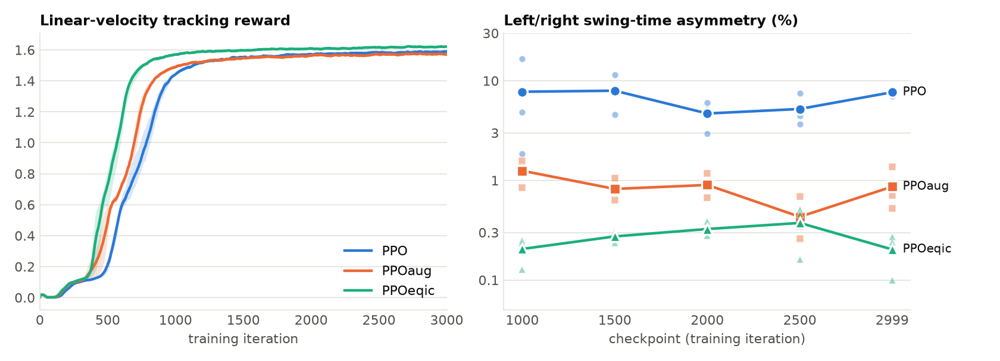
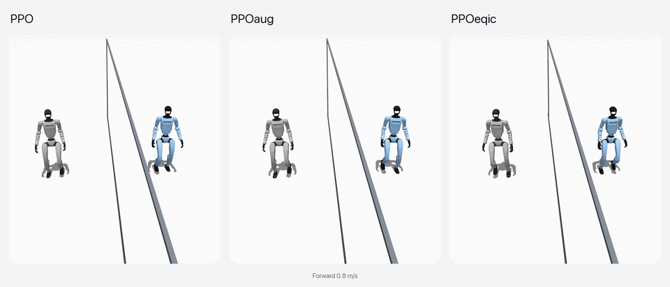
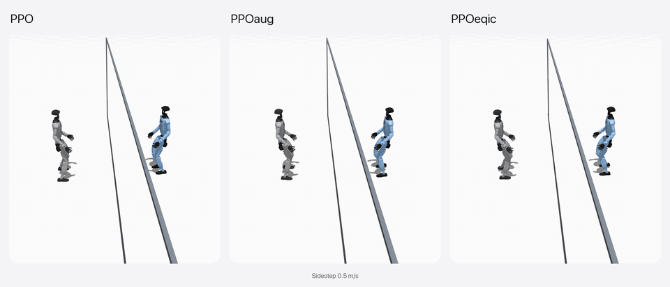
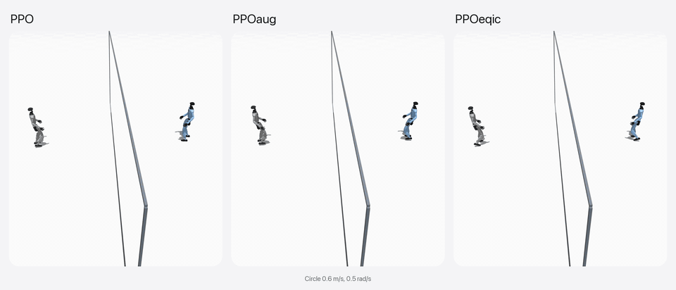

# Leveraging Symmetry in RL-based Legged Locomotion Control

This repository provides an implementation of the paper:

[**Leveraging Symmetry in RL-based Legged Locomotion Control**](https://suz-tsinghua.github.io/SymmLoco-page/)<br>
*IEEE/RSJ International Conference on Intelligent Robots and Systems (IROS)*, 2024<br>
[paper](https://arxiv.org/abs/2403.17320) / [project page](https://suz-tsinghua.github.io/SymmLoco-page/)

> [!NOTE]
> All three methods of the paper, PPO, PPO with symmetry data augmentation (PPOaug) and PPO
> with an equivariant actor-critic (PPOeqic), are now implemented on the
> [`extras`](https://github.com/leggedrobotics/rsl_rl/tree/extras) branch of rsl_rl. To make
> them easy to use, this branch is a small example built on
> [mjlab](https://github.com/mujocolab/mjlab): it trains mjlab's Unitree G1 flat-terrain
> velocity task with each of the three methods. The original Isaac Gym code is on the
> [`isaacgym/main`](https://github.com/HybridRobotics/SymmLoco/tree/isaacgym/main) and
> [`isaacgym/dribbling`](https://github.com/HybridRobotics/SymmLoco/tree/isaacgym/dribbling)
> branches.

## Setup

Install [uv](https://docs.astral.sh/uv/), then:

```bash
git clone https://github.com/HybridRobotics/SymmLoco.git
cd SymmLoco
uv sync
```

## Usage

Tasks:

- `VelocityFlat-G1-PPO`: PPO baseline
- `VelocityFlat-G1-PPOaug`: PPO with symmetry data augmentation
- `VelocityFlat-G1-PPOeqic`: PPO with an equivariant actor-critic

Train:

```bash
uv run train <TASK_ID> --env.scene.num-envs 4096 --agent.seed <SEED>
```

Play a checkpoint from a W&B run:

```bash
uv run play <TASK_ID> --wandb-run-path <ENTITY>/<PROJECT>/<RUN_ID>
```

## Results

Unitree G1, 3 seeds per method, 4096 environments, 3000 iterations.



A second robot (blue) walks behind a half mirror and gets the mirrored command. In the
mirror, the reflection of the first robot (silver) falls on top of it; a symmetric policy
keeps the two together. Click a clip for the full-resolution video.

[](https://github.com/HybridRobotics/SymmLoco/blob/assets/forward.mp4)

[](https://github.com/HybridRobotics/SymmLoco/blob/assets/sidestep.mp4)

[](https://github.com/HybridRobotics/SymmLoco/blob/assets/circle.mp4)

## Citation

```bibtex
@inproceedings{su2024leveraging,
  title={Leveraging Symmetry in RL-based Legged Locomotion Control},
  author={Su, Zhi and Huang, Xiaoyu and Ordo{\~n}ez-Apraez, Daniel and Li, Yunfei and Li, Zhongyu and Liao, Qiayuan and Turrisi, Giulio and Pontil, Massimiliano and Semini, Claudio and Wu, Yi and Sreenath, Koushil},
  booktitle={2024 IEEE/RSJ International Conference on Intelligent Robots and Systems (IROS)},
  year={2024}
}
```
